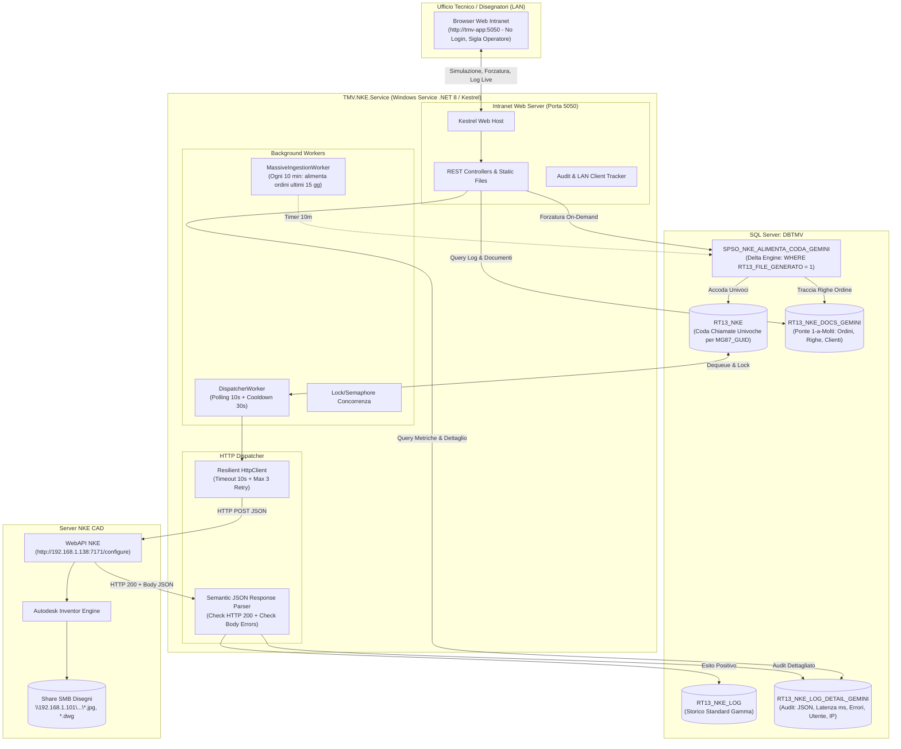
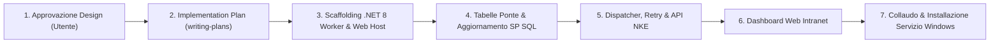

# DESIGN DOCUMENT: SERVIZIO APP SERVER & MONITOR INTRANET TMV_NKE (CAD ROBOT CONNECTOR)

> **Progetto**: Sistema di Integrazione Robotica CAD NKE  
> **Target**: Server Applicativo TMV & ERP Gamma Enterprise (`DBTMV`)  
> **Autore**: SOLVERIS - Bandera Marco  
> **Data**: 2026-10-23  
> **Stato**: Validated & Ready for Approval (Revisione Post-Reviewer & Scelte Utente Consolidate)  

---

## 1. INTENT & THE WHY

### Il Problema Attuale
L'attuale catena di integrazione tra Gamma Enterprise e il server robotizzato NKE si basa su un meccanismo legacy obsoleto:
* **Esecuzione OLE Automation su SQL Server**: la procedura `SPRT_NKE_POST` esegue chiamate HTTP POST sincrone direttamente dal motore di database tramite `sp_OAMethod MSXML2.ServerXMLHTTP`. Questa tecnica impegna thread di SQL Server per chiamate di rete esterne, è priva di connection pooling moderno, non gestisce i timeout in modo resiliente ed è storicamente deprecata da Microsoft.
* **Carenza di Trasparenza e Monitoraggio Operativo**: quando un disegno fallisce o va in timeout, non esiste alcuna interfaccia accessibile all'Ufficio Tecnico o Commerciale per diagnosticare il problema. I disegnatori non sanno se una richiesta è in coda, se l'API NKE è caduta o se la variante aveva un errore sintattico.
* **Mancanza di Strumenti di Rilancio Rapido**: per riprocessare un ordine modificato o rigenerare un file corrotto, gli utenti devono inviare ticket e segnalazioni all'IT, che a sua volta deve eseguire script SQL manuali.

### L'Obiettivo del Progetto
Progettare e realizzare un **servizio moderno e resiliente da installare sul Server Applicativo (Server APP) del cliente**, corredato da una **Web App Intranet autonoma** accessibile via browser da chiunque in azienda:
1. **Disaccoppiamento Totale tra Database e Rete**: il database SQL Server si limita a gestire code e dati transazionali (`SPSO_NKE_ALIMENTA_CODA_GEMINI`), mentre tutte le chiamate HTTP, i retry, i timeout e la gestione della rete vengono demandati al Servizio su Server APP.
2. **Monitor Operativo Live**: una dashboard web intranet chiara, performante e in stile "Swiss Office Minimal" (conforme a `/ui-ux-pro-max`) che mostra lo stato del servizio, la coda attiva, la cronologia delle chiamate, i tempi di risposta (ms) e i dettagli del JSON inviato.
3. **Consolle di Forzatura e Rilancio**: la possibilità per i disegnatori di digitare il numero di una conferma d'ordine (es. `CO 5519`), verificarla preventivamente (Dry-Run) e forzarne la rigenerazione immediata con un semplice click.

---

## 2. GOALS, NON-GOALS & ANTI-GOALS

### Goals (Cosa fa il sistema)
* **G1 - Servizio Windows Resiliente**: Un Windows Service (.NET 8 C# Worker Service) attivo h24 su Server APP, che monitora la coda in `DBTMV` a intervalli regolari (10s) e gestisce l'alimentazione massiva schedulata (10 min).
* **G2 - Chiamate HTTP Asincrone & Gestione Errori**: Esecuzione asincrona delle POST verso le WebAPI NKE (`http://192.168.1.138:7171/configure`) con timeout (10s), retry automatico con backoff (max 3 tentativi), parsing semantico della risposta e archiviazione Dead-Letter.
* **G3 - Server Web Intranet Integrato**: Esposizione di una dashboard web leggera (porta `5050` o `8080`) tramite Kestrel senza bisogno di configurare IIS.
* **G4 - Tracciabilità 1-a-Molti & Audit Trail Completo**: Visualizzazione di Ordine di provenienza (`CO 5519 R.124`), Ragione Sociale Cliente (`TUXOR S.P.A.`), Operatore richiedente, IP, Articolo, Variante, Payload JSON, Latenza in ms, Esito HTTP e messaggi di errore NKE.
* **G5 - Forzatura Manuale On-Demand**: Funzionalità interattiva da interfaccia per richiedere la generazione o sovrascrittura di un singolo ordine, richiamando `SPSO_NKE_ALIMENTA_CODA_GEMINI` con parametri `@NumDoc` e `@ForzaReinvio`.

### Non-Goals (Cosa NON fa il sistema)
* **NG1 - Nessuna modifica al Robot NKE**: Il sistema non tocca il codice sorgente né le regole iLogic di Autodesk Inventor in esecuzione sulla macchina NKE; si interfaccia rispettando fedelmente l'attuale contratto API JSON.
* **NG2 - Nessuna alterazione delle tabelle standard di Gamma**: I dati documentali di Gamma (`DO11`, `DO30`, `CO4H`) restano di esclusiva competenza dell'ERP; il servizio legge in `NOLOCK` e interagisce solo con tabelle dedicate di coda/log.
* **NG3 - Nessun client locale da installare**: Nessun software o applicazione desktop sulle postazioni dei disegnatori; l'accesso è 100% web browser.

### Anti-Goals (Cosa si vuole categoricamente evitare)
* **AG1 - Nessun blocco OLE Automation su SQL Server**: Non utilizzare più `sp_OAMethod` o chiamate sincrone dal DB.
* **AG2 - Nessuna dipendenza esterna da Cloud o Internet**: Il sistema opera al 100% in LAN interna.
* **AG3 - Nessun sovraccarico sul robot NKE**: Non inviare chiamate concorrenti che manderebbero in blocco Inventor; il dispatcher serializza rigorosamente le chiamate garantendo il cooldown minimo di 30 secondi.

---

## 3. ARCHITETTURA DI SISTEMA E FLUSSO DATI



---

## 4. COMPONENTI TECNICI DETTAGLIATI

### 4.1 Data Model & Tracciabilità 1-a-Molti (`RT13_NKE_DOCS_GEMINI`)
Per conciliare la deduplicazione tecnica (AG3: un solo invio a NKE per variante `MG87_GUID`) con il requisito di visibilità dell'Ufficio Tecnico (G4: visualizzare `CO 5519 R.124` e `TUXOR S.P.A.`):
1. **Tabella Ponte `[dbo].[RT13_NKE_DOCS_GEMINI]`**:
   * `ID_DOC_NKE` (bigint identity, PK)
   * `MG87_GUID` (uniqueidentifier, indicizzato)
   * `DO11_DITTA_CG18` (decimal 18,0)
   * `DO11_DOCUM_MG36` (varchar 20)
   * `DO11_NUMDOC` (int, indicizzato)
   * `DO11_SEZDOC` (varchar 3)
   * `DO11_ANNODOC` (smallint)
   * `DO11_DATADOC` (datetime)
   * `DO30_PROGRIGA` (int)
   * `DO30_CODART_MG66` (char 25)
   * `DO30_OPZIONE_MG5E` (char 20)
   * `RAGIONE_SOCIALE` (varchar 100)
   * `DATA_INSERIMENTO` (datetime, default getdate())
2. **Tabella Audit Estesa `[dbo].[RT13_NKE_LOG_DETAIL_GEMINI]`**:
   * `ID_LOG` (bigint identity, PK)
   * `MG87_GUID` (uniqueidentifier)
   * `MOMENTO_CHIAMATA` (datetime)
   * `LATENCY_MS` (int)
   * `HTTP_STATUS` (int)
   * `PAYLOAD_INVIATO` (nvarchar(max))
   * `RISPOSTA_RICEVUTA` (nvarchar(max))
   * `ESITO_GENERAZIONE` (bit: 1 = Generato OK, 0 = Errore)
   * `MESSAGGIO_ERRORE` (nvarchar(max))
   * `OPERATORE` (varchar 50)
   * `IP_CLIENT` (varchar 45)

### 4.2 Aggiornamento Delta Engine (`SPSO_NKE_ALIMENTA_CODA_GEMINI`)
* **Verifica Esito nel Delta**: il controllo di esistenza pregresso in `RT13_NKE_LOG` viene rettificato in:
  ```sql
  WHERE l.MG87_GUID = c.MG87_GUID AND l.RT13_FILE_GENERATO = 1
  ```
  Se un record ha fallito la generazione in passato (`RT13_FILE_GENERATO = 0`), non viene classificato come `GIA_A_LOG`, consentendo il recupero automatico o manuale.
* **Alimentazione Tabella Ponte**: la stored procedure, contestualmente all'inserimento deduplicato in `RT13_NKE`, popola `RT13_NKE_DOCS_GEMINI` con tutte le righe d'ordine associate al lotto in elaborazione.

### 4.3 Dispatcher & Client HTTP Resiliente
1. **Polling e Serializzazione**:
   * Scansione ogni 10s su `RT13_NKE` ordinata per data inserimento.
   * Verifica Cooldown: almeno 30 secondi trascorsi dall'ultima chiamata NKE.
2. **Chiamata WebAPI & Parsing Semantico**:
   * Endpoint: `POST http://192.168.1.138:7171/configure`.
   * Timeout socket: 10 secondi.
   * **Doppia Validazione Esito**: il servizio non si fida solo dell'HTTP 200, ma analizza il body JSON di risposta per intercettare anomalie iLogic/CAD (es. flag `Error`, `Failed`, campi `Exception`).
3. **Gestione Retry e Dead-Letter (Scarto Terminale)**:
   * Tentativi 1 e 2: backoff esponenziale (30s, 60s), incremento `RT13_NUM_TENTATIVI`.
   * Tentativo 3 fallito: il record viene marcato come **Dead-Letter** (`RT13_FILE_GENERATO = 0`), cancellato dalla coda `RT13_NKE` per non bloccare la pipeline, e registrato in `RT13_NKE_LOG_DETAIL_GEMINI` con l'errore diagnostico completo. L'evento genera un alert visivo immediato nella dashboard.

### 4.4 Ingestion Massiva Integrata (Worker Schedulato)
* Il servizio Windows integra al proprio interno il modulo `MassiveIngestionWorker` configurato con un timer periodico (default ogni 10 minuti, personalizzabile in `appsettings.json`).
* Innesca `SPSO_NKE_ALIMENTA_CODA_GEMINI @ModalitaDryRun = 0, @NumDoc = NULL, @GiorniIndietro = 15`.
* Un semaforo/lock interno garantisce la mutua esclusione tra il worker schedulato massivo e le forzature manuali avviate dagli operatori via interfaccia web.

### 4.5 Sicurezza e Profilazione Intranet
* **Accesso LAN Diretto**: navigazione aperta su rete aziendale (`http://app-srv:5050`) senza form di login.
* **Audit Operatore al Click di Forzatura**: al click sui pulsanti "Simula" o "Invia Subito a NKE", l'interfaccia richiede la sigla/nome dell'operatore (es. `MB`, `UffTecnico`), che viene trasmessa via API e salvata nel log con l'indirizzo IP del computer richiedente.

---

## 5. SPECIFICA DELLE API REST INTERNE

Tutte le API operano in JSON su porta configurabile (default `5050`):

| Metodo | Endpoint | Descrizione |
|---|---|---|
| `GET` | `/api/status` | Stato del servizio, uptime, connessione DBTMV e ping WebAPI NKE |
| `GET` | `/api/kpis` | Metriche aggregate 24h: in coda, inviati con successo, errori, latenza media |
| `GET` | `/api/queue` | Elementi attualmente in attesa nella coda `RT13_NKE` con dettagli ordine |
| `GET` | `/api/logs` | Log storico paginato (filtro per Ordine, Cliente, Articolo, Esito) |
| `GET` | `/api/logs/{id}/payload` | Ritorna il payload JSON inviato e la risposta NKE ricevuta |
| `POST` | `/api/orders/simulate` | Esegue Dry-Run (`SPSO_... @ModalitaDryRun = 1, @NumDoc = ...`) |
| `POST` | `/api/orders/force` | Esegue forzatura reale (`SPSO_... @ModalitaDryRun = 0, @NumDoc = ..., @ForzaReinvio = 1`) |

---

## 6. PIANO DI RILASCIO & FASI SUCCESSIVE



> **Prossimo Passo Operativo**: Ottenuta la convalida dell'utente sul presente documento di design, si invocherà la skill `superpowers:writing-plans` per produrre il piano di implementazione dettagliato con sequenza di task verificabili e collaudi mirati.
