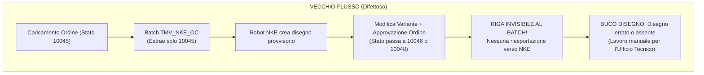
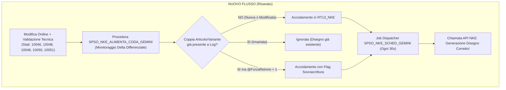

# DOCUMENTO TECNICO DI PROGETTO: REVISIONE PROCESSO TMV_NKE (ALIMENTAZIONE ROBOT CAD NKE)

> **Progetto**: ERP Gamma Enterprise / Integrazione Disegni CAD Robotizzati NKE  
> **Oggetto**: Risanamento architetturale del flusso di generazione ed esportazione disegni tecnici  
> **Autore**: SOLVERIS - Bandera Marco  
> **Data**: 23 Ottobre 2026  
> **Versione Documento**: Rev. 1.0  
> **Database di Riferimento**: `DBTMV` (MSSQL 14.0.2120.1 - SQL Server 2017)  

---

## SOMMARIO ESECUTIVO

Il presente documento formalizza la revisione completa del processo di integrazione tra il sistema ERP aziendale **Gamma Enterprise** e la cella robotizzata di creazione automatica disegni tecnici CAD 3D (Autodesk Inventor / iLogic) fornita dal partner tecnologico **NKE**.

A seguito di un'analisi diagnostica approfondita scaturita da una segnalazione dell'Ufficio Tecnico (relativa alla conferma d'ordine cliente **CO 5519 - TUXOR**), è emerso che l'architettura preesistente basata sull'Insieme batch ImpExp `TMV_NKE` perdeva sistematicamente tutte le modifiche e le revisioni dimensionali apportate alle conferme d'ordine successivamente al loro inserimento iniziale.

La nuova soluzione ingegnerizzata elimina i punti di fallimento strutturali mediante l'introduzione di una Stored Procedure transazionale di alimentazione (`SPSO_NKE_ALIMENTA_CODA_GEMINI`), la revisione del motore di dispatching HTTP (`SPSO_NKE_SCHED_GEMINI`) e la disattivazione del tracciato batch difettoso.

---

# PARTE 1: LOGICHE DI BUSINESS (PER UTENTI FINALI E MANAGEMENT)

### 1.1 Il Contesto Operativo e lo Scopo Aziendale
Nell'operatività quotidiana di TMV, la corretta e tempestiva generazione dei disegni tecnici dei prodotti speciali (tiranti filettati, stud-bolt DIN 938/939, viti a testa quadra e bulloneria speciale a disegno) è propedeutica a due fasi critiche:
1. **Invio dell'ordine approvato al Cliente**: il cliente finale riceve la conferma d'ordine commerciale corredata dal fascicolo dei disegni costruttivi per approvazione formale.
2. **Pianificazione e Produzione di Officina**: gli Uffici Programmazione e Produzione utilizzano le quote e le sezioni dei file DWG/PDF per istruire i torni a controllo numerico (CNC), le rullatrici e i centri di collaudo.

Il processo è automatizzato mediante un robot CAD NKE che espone un'interfaccia API in grado di ricevere i codici articolo e le relative varianti, modellare il pezzo 3D e salvare il disegno tecnico definitivo in una cartella di rete condivisa.

---

### 1.2 La Segnalazione dell'Ufficio Tecnico e l'Anomalia Rilevata
In data 20/10/2026 l'Ufficio Tecnico ha riscontrato un'importante anomalia sulla conferma d'ordine **CO 5519 (Cliente TUXOR)**:
* L'ordine conteneva numerose posizioni (in particolare dal prog. 63 al prog. 108) che, nella bozza iniziale del 30/09, erano state inserite con codifiche provvisorie e varianti errate.
* Il 01/10 era stata eseguita una prima modifica e il 02/10 le righe erano state corrette definitivamente in articoli **PDN** con quote accurate, dopodiché la conferma d'ordine era stata validata ed approvata dalla Direzione.
* Quando il fascicolo è giunto ai disegnatori per l'invio al cliente, tutti i file DWG presenti su disco risultavano generati con le misure errate della prima bozza. I disegni corretti non erano mai stati creati dal robot, costringendo il personale tecnico a disegnare manualmente circa 50 particolari.

La richiesta dell'Ufficio Tecnico sollevava interrogativi cruciali:
> *"Quanti export eseguite? Ad ogni modifica? All'approvazione? È possibile riesportare singole conferme d'ordine per farle riprocessare dal robot senza dover attendere la notte o toccare query di sistema?"*

---

### 1.3 Causa Radice del Problema (Root Cause Analysis)
L'indagine tecnica sul database di produzione/staging ha evidenziato il limite intrinseco della vecchia impostazione:
* **Filtro statico ed esclusivo su Stato Bozza**: il vecchio tracciato ImpExp `TMV_NKE_OC` estraeva esclusivamente le righe aventi **Stato Riga = 10045 ('Generato')**.
* **Perdita delle modifiche**: quando una conferma viene modificata e approvata, le sue righe avanzano nello stato di workflow (es. `10046 - DIBA Localizzata`, `10048 - Approv.Uff.DIR`, `10051 - ODL Generato`).
* **Buchi nei disegni**: una volta uscite dallo stato 10045, le righe diventavano totalmente "invisibili" per il batch. Se un utente modificava una misura alle ore 10:00 e alle 11:00 approvava l'ordine, il batch della notte successiva ignorava la riga. Il robot NKE conservava solo il vecchio disegno o non riceveva affatto la nuova combinazione articolo/variante.



---

### 1.4 La Nuova Logica Adottata e i Benefici per l'Azienda
Con il nuovo impianto:
1. **Innesco all'Approvazione e negli Stati Operativi**:
   Il sistema monitora le righe ordine quando raggiungono gli stati in cui i dati tecnici sono certi e validati: **10046 (DIBA Localizzata), 10048 (Approvazione Direzionale), 10049 (Inviata Mail Cliente), 10050 (Preso in carico Produzione), 10051 (ODL Generato), 10054 (Ordine Fornitore) e 10055 (DIBA Non necessaria)**.
2. **Monitoraggio Differenziale Intelligente (Delta Engine)**:
   Il nuovo motore confronta ogni riga con l'archivio storico delle trasmissioni (`RT13_NKE_LOG`). Se un articolo cambia variante (es. lunghezza filetto o passo modificato), la nuova combinazione viene riconosciuta istantaneamente come inedita e spedita al robot.
3. **Piena Autonomia di Rilancio per Singola Conferma d'Ordine**:
   Gli operatori e l'Ufficio Tecnico possono lanciare la procedura per una specifica conferma d'ordine (es. `CO 5519`), sia per verificarla preventivamente a video in modalità simulata (Dry-Run), sia per forzarne la rigenerazione immediata con un semplice comando.



---

# PARTE 2: SCELTE TECNICHE E ARCHITETTURA DI SISTEMA (PER SVILUPPATORI E IT)

### 2.1 Mappa degli Oggetti di Integrazione
L'infrastruttura di interscambio poggia sui seguenti elementi del database `DBTMV`:

| Oggetto SQL | Tipologia | Ruolo e Funzione |
| :--- | :--- | :--- |
| `SPSO_NKE_ALIMENTA_CODA_GEMINI` | Stored Procedure | **Produttore**: estrae le righe ordine idonee, esegue il confronto delta ed accoda in `RT13_NKE`. |
| `SPSO_NKE_SCHED_GEMINI` | Stored Procedure | **Consumatore**: invia le richieste HTTP POST verso l'API NKE, gestisce ritardi e retry. |
| `SPRT_NKE_POST` | Stored Procedure | Procedura atomica OLE Automation (`sp_OAMethod MSXML2.ServerXMLHTTP`) che invia il JSON. |
| `RT13_NKE` | Tabella Coda | Tabella transizionale di appoggio contenente le richieste in attesa di invio verso NKE. |
| `RT13_NKE_LOG` | Tabella Storico | Archivio storico di tutte le chiamate effettuate, popolata automaticamente via trigger. |
| `RT13_AFTER_DELETE` | Trigger | Trigger su `RT13_NKE`: sposta deterministicamente ogni riga cancellata in `RT13_NKE_LOG`. |
| `CM02_VALORICATCOMM` | Tabella ERP | Configurazione commerciale categorie: solo i prefissi con `CM02_A = 'NKE'` vanno al CAD. |
| `MG87_ARTDESC` | Tabella ERP | Tabella anagrafica descrizioni articoli/varianti da cui si ricava il `MG87_GUID` univoco. |
| `Job [TMV.NKE - Genera disegni]` | SQL Agent Job | Esegue ogni 30 secondi il dispatcher per smaltire la coda `RT13_NKE`. |

---

### 2.2 Dettaglio della Stored Procedure Produttore: `[dbo].[SPSO_NKE_ALIMENTA_CODA_GEMINI]`

#### Parametri di Firma:
```sql
CREATE PROCEDURE [dbo].[SPSO_NKE_ALIMENTA_CODA_GEMINI]
    @ModalitaDryRun     BIT          = 1,       -- 1 = Simulazione Verbosa (Dry-Run), 0 = Scrittura Reale
    @NumDoc             INT          = NULL,    -- Numero Conferma Ordine (se NULL, elaborazione massiva)
    @AnnoDoc            SMALLINT     = NULL,    -- Anno Documento (default: anno corrente)
    @SezDoc             VARCHAR(3)   = NULL,    -- Sezionale Documento (se NULL, tutti)
    @GiorniIndietro     INT          = 15,      -- Finestra lookback per batch massivo (default: 15 giorni)
    @ForzaReinvio       BIT          = 0        -- 1 = Bypassa storico e forza RT13_SOVRASCRIVI = 1
```

#### Logica di Selezione e Predicati Ottimizzati:
1. **Filtro Testata e Corpo Documento**:
   * Documenti di vendita: `DO11_DOCUM_MG36 IN ('DC-ORDINE', 'DC-ORDGAR')` e `DO11_TIPODOC = 21`.
   * Lunghezza codice articolo: `LEN(TRIM(DO30_CODART_MG66)) = 14`.
   * Verifica Categoria NKE: `SUBSTRING(DO30_CODART_MG66, 1, 3) = SUBSTRING(CM02_VALORESTR, 1, 3)` con `CM02_IDCATEGORIA_CM01 = 1` e `ISNULL(CM02_A, '') = 'NKE'`.
2. **Perimetro Stati Riga Approvati/Operativi**:
   * Righe con stato attuale (`CO4C_IDENTITA_CO4A = 8`) appartenente alla lista validata:
     `CO4C_IDSTATO IN (10046, 10048, 10049, 10050, 10051, 10054, 10055)`.
3. **Delta Engine ad Alte Prestazioni**:
   * Evita le `LEFT JOIN` dirette su `RT13_NKE_LOG` che causavano esplosione cartesiana delle righe (fino a 128 duplicati per GUID).
   * Utilizza costrutti `OUTER APPLY (SELECT TOP 1 ...)` indicizzati per verificare all'istante l'esistenza dello storico.
4. **Deduplicazione Coda**:
   * In fase di inserimento in `RT13_NKE`, le righe vengono raggruppate per `MG87_GUID`. Se uno stesso articolo/variante compare su 10 posizioni dello stesso ordine, viene inserito un singolo record in coda, risparmiando il 90% delle chiamate API verso il server NKE.

---

### 2.3 Dettaglio della Stored Procedure Consumatore: `[dbo].[SPSO_NKE_SCHED_GEMINI]`
La procedura risana i difetti riscontrati nella storica `SPRT_NKE_SCHED`:
1. **Risoluzione Bug Cooldown Temporale**:
   * Vecchio codice: `DATEADD(SECOND, @SecondiTraChiamate, GETDATE())` sommava 30 secondi nel futuro.
   * Nuovo codice: `DATEADD(SECOND, -ABS(@SecondiTraChiamate), GETDATE())` sottrae correttamente i secondi di delay, assicurando che tra un tentativo e il successivo intercorra il tempo configurato in `RT14_VARIABILI_READYTEC`.
2. **Supporto Nativo Dry-Run**:
   * Con `@ModalitaDryRun = 1`, visualizza il payload JSON formattato che verrebbe inviato a `http://192.168.1.138:7171/configure` senza invocare l'oggetto OLE Automation.
3. **Gestione Tentativi ed Eliminazione Coda**:
   * Ad ogni invio, incrementa `RT13_NUM_TENTATIVI`.
   * Al superamento di 1 tentativo, la riga viene rimossa da `RT13_NKE`, innescando il trigger `RT13_AFTER_DELETE` che popola `RT13_NKE_LOG`.

---

### 2.4 Evidenze di Collaudo sul Caso Studio Reale (CO 5519)
L'esecuzione della procedura in modalità simulata sulla conferma d'ordine **CO 5519** ha fornito i seguenti risultati matematici:

```
===================================================================================================
TEST COLLAUDO SU CO 5519 TUXOR (SPSO_NKE_ALIMENTA_CODA_GEMINI @ModalitaDryRun = 1, @NumDoc = 5519)
===================================================================================================
STATO OPERATIVO                                    | Righe Analizzate | Da Accodare | Già a Log | In Coda
---------------------------------------------------+------------------+-------------+-----------+---------
DRYOUT VERBOSO - SIMULAZIONE ALIMENTAZIONE NKE     | 161              | 68          | 93        | 0
```

* **93 righe** (viti e tiranti standard non modificati) sono state riconosciute come `GIA_A_LOG` e correttamente ignorate.
* **68 righe** (tra cui tutte le posizioni dal prog. 124 al prog. 207 corrispondenti alle revisioni PDN in stato 10046) sono state identificate con esito **`DA_INSERIRE_NUOVO`**.
* Questo dimostra che, se il nuovo motore fosse stato attivo il 02/10, i disegni CAD sarebbero stati generati automaticamente senza alcun intervento manuale.

---

# PARTE 3: APPENDICE SORGENTI COMPLETI

### 3.1 Script 1: Creazione `[dbo].[SPSO_NKE_ALIMENTA_CODA_GEMINI]`
```sql
-- Consultare il file sorgente completo nel workspace:
-- C:\Users\marco\OneDrive\Documenti\READYTEC\TMV\VSCODE - TMV\DISEGNI CAD - NKE\SPSO_NKE_ALIMENTA_CODA_GEMINI.sql
```

### 3.2 Script 2: Creazione `[dbo].[SPSO_NKE_SCHED_GEMINI]`
```sql
-- Consultare il file sorgente completo nel workspace:
-- C:\Users\marco\OneDrive\Documenti\READYTEC\TMV\VSCODE - TMV\DISEGNI CAD - NKE\SPSO_NKE_SCHED_GEMINI.sql
```

### 3.3 Script 3: Disattivazione Tracciato ImpExp Obsoleto
```sql
USE [DBTMV];
GO
UPDATE dbo.IE34_INSIEMIDETT
SET IE34_FLGATTIVO = 0
WHERE IE34_INSIEME_IE33 = 'TMV_NKE' 
  AND IE34_TRACCIATO_IE25 = 'TMV_NKE_OC';
GO
```

### 3.4 Script 4: Istruzioni di Esecuzione Operativa e Rilancio
```sql
-- 1. Simulazione verifica singola conferma d'ordine (es. CO 5519):
EXEC dbo.SPSO_NKE_ALIMENTA_CODA_GEMINI @ModalitaDryRun = 1, @NumDoc = 5519;

-- 2. Esecuzione reale accodamento per singola conferma d'ordine:
EXEC dbo.SPSO_NKE_ALIMENTA_CODA_GEMINI @ModalitaDryRun = 0, @NumDoc = 5519;

-- 3. Forzatura riaccodamento integrale con sovrascrittura file CAD:
EXEC dbo.SPSO_NKE_ALIMENTA_CODA_GEMINI @ModalitaDryRun = 0, @NumDoc = 5519, @ForzaReinvio = 1;

-- 4. Esecuzione massiva schedulata (default ultimi 15 giorni):
EXEC dbo.SPSO_NKE_ALIMENTA_CODA_GEMINI @ModalitaDryRun = 0, @GiorniIndietro = 15;
```

---
*Documento redatto da SOLVERIS per conto di TMV.*

