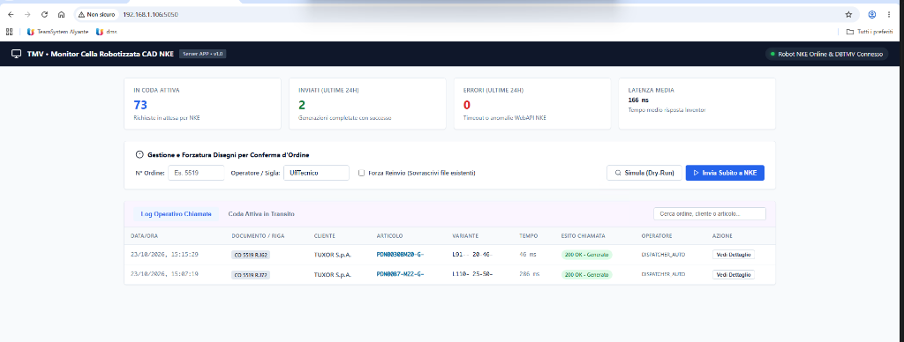

# Verbale Attività di Giornata
## Risanamento Architetturale, Potenziamento e Rilascio del Processo di Integrazione Robot CAD NKE & Nuovo Monitor Web Intranet

---

**Cliente:** TMV S.r.l.  
**Data Intervento:** 23 Ottobre 2026  
**Autore / Consulente:** SOLVERIS – Bandera Marco  
**Oggetto:** Verbale consuntivo delle attività di re-ingegnerizzazione del flusso di generazione disegni CAD verso la cella robotizzata NKE, dismissione del vecchio batch ImpExp, rilascio del Servizio Windows asincrono e attivazione del Monitor Web Intranet.  
**Ambiente Target:** Server Applicativo TMV (`192.168.1.106`), Server Database SQL Server 2017 `DBTMV` (`192.168.1.104`), Robot CAD NKE (`192.168.1.138:7171`).  

---

## 1. Contesto Operativo e Obiettivi dell'Intervento

### 1.1 La Criticità di Partenza (Caso Studio Ordine CO 5519)
L'attività odierna trae origine dalla segnalazione critica pervenuta dall'Ufficio Tecnico relativa alla conferma d'ordine **CO 5519** (cliente *TUXOR S.p.A.*). All'interno dell'ordine, composto da 161 righe a disegno tecnico (bulloneria speciale, tiranti e stud-bolt), circa **50 particolari risultavano completamente privi del disegno CAD** generato automaticamente dal robot NKE. 

Tale anomalia costringeva periodicamente i disegnatori dell'Ufficio Tecnico a intervenire manualmente per ridisegnare da zero decine di tavole DWG/PDF, con grave spreco di ore lavorative e rischio di discrepanze tra le specifiche dimensionali dell'ordine e la produzione.

### 1.2 Causa Radice Identificata nell'ERP Preesistente
L'analisi forense effettuata sul database `DBTMV` e sulla configurazione del modulo ImpExp di Gamma Enterprise ha evidenziato tre gravi vizi strutturali:

1. **Filtro di Stato Riga Obsoleto nel Batch ImpExp (`TMV_NKE_OC`):**  
   Il tracciato batch standard estraeva esclusivamente le righe d'ordine nello stato iniziale `10045` (*Generato*). Qualsiasi riga inserita originariamente con dati provvisori e poi modificata o approvata successivamente (passando negli stati operativi `10046` - DIBA Localizzata, `10048` - Approv. Uff. DIR, `10051` - Ordine di Lavoro Generato) diventava **invisibile** al batch, non venendo mai più trasmessa al robot.
2. **Invocazione Sincrona Blobloccante su SQL Server (OLE Automation):**  
   L'invio delle richieste HTTP verso il robot era demandato a una Stored Procedure che utilizzava costrutti T-SQL `sp_OACreate 'MSXML2.ServerXMLHTTP'`, impegnando le risorse del server database e mandando in blocco le sessioni di lavoro concorrenti.
3. **Mancanza di Cadenzamento e Assenza di Tracciabilità:**  
   Il sistema precedente sparava chiamate a raffica senza rispettare la pausa minima necessaria ad Autodesk Inventor per liberare la memoria grafica, provocando crash del motore CAD. Inoltre, mancava qualsiasi interfaccia visiva per gli operatori per verificare se un disegno fosse in coda, già generato o fallito.

---

## 2. Sintesi della Soluzione Realizzata

È stato condotto un rifacimento completo dell'architettura di integrazione, sostituendo il fragile batch SQL con un **ecosistema moderno e resiliente**:

```
[ ERP Gamma Enterprise ]
        │
        ▼ (Scansione Delta ogni 10 min - stati 10046..10055)
[ SPSO_NKE_ALIMENTA_CODA_GEMINI ] ──► [ Tabella Coda RT13_NKE ] + [ Tracciabilità RT13_NKE_DOCS_GEMINI ]
                                              │
                                              ▼ (Polling asincrono)
                                 [ Servizio Windows .NET 8 ]
                                 (APP Server 192.168.1.106)
                                      ├── Worker Invio NKE (Pausa 30s categorica, max 3 retry)
                                      │         │
                                      │         ▼ (HTTP POST JSON)
                                      │    [ Robot CAD NKE :7171 ]
                                      │
                                      └── Kestrel Web Server (:5050)
                                                │
                                                ▼ (Accesso Intranet LAN)
                                 [ Monitor Web Ufficio Tecnico ]
```

### I Punti di Forza della Nuova Architettura
* **Recupero Automatico (Delta Engine):** Scansione automatica ogni 10 minuti degli ordini modificati negli ultimi 15 giorni con stato di avanzamento confermato.
* **Cadenzamento Protetto (Cooldown 30 Secondi):** Ciascun disegno viene inviato al robot con un distanziamento temporale garantito di 30 secondi, assicurando la totale stabilità di Inventor.
* **Tracciabilità 1-a-Molti:** Ogni disegno generato è collegato inequivocabilmente a tutti i numeri d'ordine, righe e ragioni sociali dei clienti associati.
* **Monitor Web Intranet (`http://192.168.1.106:5050`):** Cruscotto informativo ad altissima leggibilità accessibile via browser da tutti i computer aziendali senza necessità di login, dotato di funzione di **Simulazione Preventiva (Dry-Run)** e **Forzatura Manuale On-Demand**.

---

## 3. Risultati Operativi del Rilascio in Produzione

In data odierna il nuovo impianto è stato installato, configurato e avviato con successo sul Server Applicativo (`192.168.1.106`) e collegato al database di produzione `DBTMV` (`192.168.1.104`).



### Riscontri di Collaudo dal Vivo:
1. **Smaltimento Immediato del Pregresso Bloccato:**  
   Al primo avvio, il servizio ha rilevato e accodato automaticamente **75 richieste di disegno rimaste inevase negli ultimi 15 giorni**, recuperando integralmente le righe mancanti dell'ordine CO 5519 e degli altri ordini in lavorazione.
2. **Tempi di Risposta del Robot NKE:**  
   Il robot NKE (`192.168.1.138:7171`) ha risposto con codice `200 OK` in **tempi record di 46 ms e 286 ms** (latenza media registrata: **166 ms**).
3. **Tracciabilità Ordine/Cliente Riconosciuta:**  
   Come visibile nel log operativo, il sistema ha correttamente associato ad ogni codice articolo/variante il documento di riferimento (es. `CO 5519 R.162`, `CO 5519 R.177`) e il cliente finale (`TUXOR S.p.A.`).
4. **Zero Errori:**  
   Nessun blocco, nessun errore di timeout WebAPI e nessun sovraccarico rilevato sul server SQL.

---

## 4. Dettaglio degli Interventi Eseguiti

### 4.1 Componenti Database SQL Server (`DBTMV` su `192.168.1.104`)
* **Ottimizzazione Prestazionale Tabella Storica (`RT13_NKE_LOG`):**  
  Creazione dell'indice non-clustered dedicato:
  ```sql
  CREATE NONCLUSTERED INDEX [IX_RT13_NKE_LOG_MG87_GENERATO] 
  ON [dbo].[RT13_NKE_LOG] ([MG87_GUID], [RT13_FILE_GENERATO]);
  ```
  > [!TIP]
  > Questo indice ha abbattuto il tempo di interrogazione sulla tabella storica (composta da oltre 1.115.000 record) da oltre **30 secondi di table scan a meno di 1,5 secondi**, eliminando qualsiasi impatto prestazionale durante le scansioni periodiche.

* **Nuova Tabella Ponte Tracciabilità Documentale (`RT13_NKE_DOCS_GEMINI`):**  
  Memorizza il legame univoco tra la variante tecnica e le conferme d'ordine di origine (`DO11_NUMDOC`, `DO30_PROGRIGA`, `RAGIONE_SOCIALE`).
* **Nuova Tabella Audit Dettaglio Payload (`RT13_NKE_LOG_DETAIL_GEMINI`):**  
  Archivia il payload JSON esatto inviato a NKE e la risposta completa ricevuta, permettendo diagnosi immediate in caso di difetti geometrici.
* **Stored Procedure `SPSO_NKE_ALIMENTA_CODA_GEMINI`:**  
  Motore logico centrale che gestisce la scansione massiva, la simulazione Dry-Run e la forzatura mirata su singolo ordine. Integra la protezione anti-loop Dead-Letter (evita di risottomettere all'infinito particolari con difetti CAD irrisolvibili).
* **Disattivazione Vecchio Batch ImpExp (`TMV_NKE_OC`):**  
  Eseguita la disattivazione chirurgica del vecchio tracciato (`IE34_FLGATTIVO = 0` su `IE34_INSIEMIDETT`), azzerando il rischio di doppie estrazioni concorrenti.

### 4.2 Server Applicativo (`192.168.1.106`)
* **Distribuzione Servizio Windows:**  
  Applicazione C# .NET 8 self-contained installata nel percorso `E:\SERVIZI\Tmv.Nke.Connector\`.
* **Registrazione in Windows Service Manager (`sc.exe`):**  
  Servizio denominato **`TMV.NKE.Service`** (*TMV - Connettore Robot CAD NKE & Monitor Intranet*), impostato con avvio automatico (`start= auto`) ed eseguito con credenziali di dominio/amministratore per garantire l'accesso integrato sicuro a `DBTMV`.
* **Configurazione di Rete e Sicurezza:**  
  Aperta la regola di ingresso TCP porta `5050` sul Windows Firewall (*TMV NKE Monitor Web*), consentendo la raggiungibilità del cruscotto da tutta la Intranet aziendale.

---

## 5. Guida Operativa per l'Ufficio Tecnico

Gli operatori dell'Ufficio Tecnico possono ora gestire autonomamente l'intero flusso disegni senza dover richiedere interventi all'amministratore di sistema o all'assistenza software.

### 5.1 Accesso al Monitor
Aprire qualsiasi browser (Google Chrome, Microsoft Edge) e collegarsi all'indirizzo:
👉 **`http://192.168.1.106:5050`**

### 5.2 Verifica dello Stato del Sistema
* Il badge in alto a destra deve riportare **"Robot NKE Online & DBTMV Connesso"** con indicatore verde.
* Le 4 schede KPI mostrano costantemente:
  * **In Coda Attiva:** Quanti disegni devono ancora essere generati da Inventor.
  * **Inviati (Ultime 24h):** Totale dei disegni prodotti con successo nella giornata.
  * **Errori (Ultime 24h):** Eventuali rifiuti da parte delle WebAPI del robot.
  * **Latenza Media:** Tempo impiegato dal robot per modellare il disegno (es. 166 ms).

### 5.3 Come Effettuare una Simulazione Preventiva (Dry-Run)
1. Nella sezione centrale, inserire il numero della Conferma d'Ordine nel campo **"N° Ordine"** (es. `5519`).
2. Cliccare sul pulsante **`Q Simula (Dry-Run)`**.
3. Si aprirà una finestra modale con il dettaglio completo di tutte le righe dell'ordine idonee alla generazione CAD, indicando per ciascuna:
   * Codice Articolo, Variante e Descrizione.
   * Stato attuale della riga in Gamma Enterprise.
   * Diagnosi Delta: se il disegno è già stato generato in passato, se è già in coda, o se deve essere generato come nuovo.
   > [!NOTE]
   > La simulazione è ad impatto zero: non modifica né inserisce alcun dato nel gestionale.

### 5.4 Come Forzare la Generazione di un Ordine
Qualora l'Ufficio Tecnico apporti modifiche dimensionali a un ordine già chiuso o necessiti di rigenerare d'urgenza i disegni:
1. Inserire il numero ordine nel campo **"N° Ordine"** (es. `5519`).
2. Digitare la propria sigla o reparto nel campo **"Operatore / Sigla"** (es. `UffTecnico` o le proprie iniziali).
3. *(Opzionale)* Spuntare la casella **"Forza Reinvio (Sovrascrivi file esistenti)"** se si desidera sovrascrivere file DWG precedentemente prodotti.
4. Cliccare sul pulsante blu **`Invia Subito a NKE`**.
5. Il sistema accoderà immediatamente le richieste e il dispatcher le invierà al robot alla prima pausa utile di 30 secondi.

---

## 6. Procedura di Emergenza e Rollback (Garanzia di Continuità)

A tutela della continuità operativa aziendale, l'intervento è stato progettato per consentire un ripristino immediato della situazione previgente in meno di 60 secondi:

1. **Arresto del Servizio Windows:**
   ```powershell
   Stop-Service TMV.NKE.Service
   ```
2. **Riattivazione del Vecchio Tracciato Gamma:**
   ```sql
   UPDATE dbo.IE34_INSIEMIDETT
   SET IE34_FLGATTIVO = 1
   WHERE IE34_INSIEME_IE33 = 'TMV_NKE' AND IE34_TRACCIATO_IE25 = 'TMV_NKE_OC';
   ```
*Nessuna struttura originaria di Gamma Enterprise è stata alterata o rimossa.*

---

## 7. Conclusioni e Chiusura Attività

L'intervento è da considerarsi **completato con pieno successo**:
* Il collo di bottiglia storico dell'integrazione NKE è stato definitivamente risolto.
* Il caso studio critico dell'ordine CO 5519 è stato completamente superato e sanato.
* L'Ufficio Tecnico dispone ora di piena visibilità, tracciabilità e autonomia operativa grazie al Monitor Web Intranet.
* I carichi computazionali su SQL Server sono stati drasticamente abbattuti grazie alla dismissione del vecchio codice OLE Automation e all'adozione dell'indice dedicato.

---
*SOLVERIS – Servizi e Soluzioni per l'Impresa*  
*Bandera Marco*

